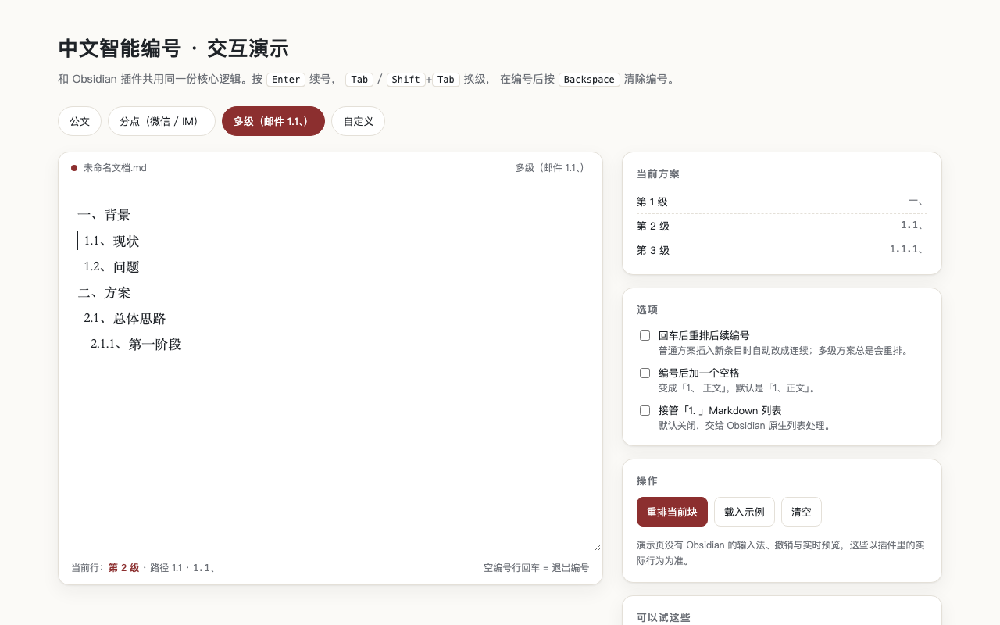
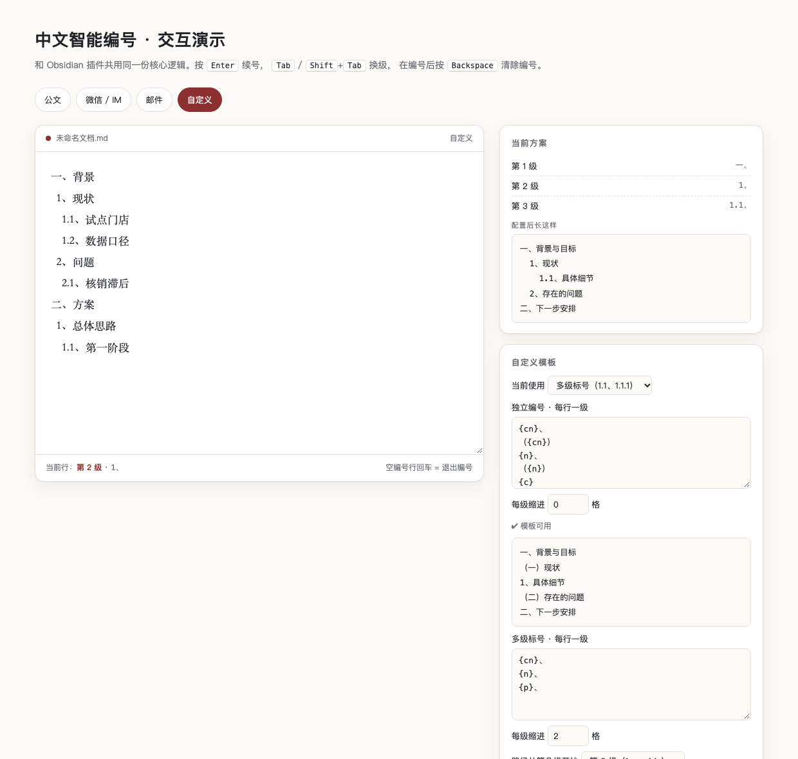

# 中文智能编号 · Smart Chinese Numbering

> 给 Obsidian 写**中文序号**的插件：`一、` `1、` `1.1、`，回车自动续号、Tab 换级，再也不会被 Markdown 改写成 `1.`。公文 / 微信 / 邮件 / 自定义四套方案，状态栏一键切换。



## 快速开始

**方式一 · 官方插件市场（推荐）**
1. Obsidian → `设置` → `第三方插件` → 关闭「安全模式」
2. 点 `浏览` 打开社区插件市场，搜索 **`中文智能编号`**（或 `Smart Chinese Numbering`）
3. 安装并启用即可

**方式二 · 手动安装**
```bash
VAULT="/path/to/your/vault"
mkdir -p "$VAULT/.obsidian/plugins/chinese-smart-numbering"
cp main.js manifest.json styles.css "$VAULT/.obsidian/plugins/chinese-smart-numbering/"
```
然后在 `设置 → 第三方插件` 重载并启用。

## 四套方案

| 方案 | 长这样 | 适合 |
| --- | --- | --- |
| **公文** | `一、` `（一）` `1、` `（1）` `①` | 通知、报告、请示、纪要 |
| **微信 / IM** | `一、` → `  1、` | 微信长回复、即时消息 |
| **邮件** | `一、` → `  1、` → `    1.1、` | 邮件、周报、方案 |
| **自定义** | 独立编号 / 多级标号两套模板 | `第X条`、纯数字大纲等 |

每级默认缩进 2 空格；状态栏「编号：公文」点一下即可切换方案。

## 怎么用

| 操作 | 效果 |
| --- | --- |
| `Enter`（编号行末尾） | 下一行写同款编号 +1；邮件方案自动重排整块 |
| `Enter`（空编号行） | 退出编号 |
| `Tab` / `Shift+Tab` | 换级 / 升级；按方案自动缩进 |
| `Backspace`（紧跟编号） | 删除整段编号，正文与缩进保留 |

中文输入法组词时完全不介入，回车选词不受影响。

## 自定义模板

设置中选「自定义」后，得到**两套互相独立的配置**（独立编号 / 多级标号），用「当前使用」决定哪套生效，下方实时预览配置后的样子。



占位符：`{cn}` 中文数字、`{n}` 阿拉伯数字、`{c}` 圈号、`{p}` 多级路径（如 `1.1、`）。

## 命令与设置

- **命令**：重排当前编号块、编号升 / 降级、切换四套方案、开关智能编号。
- **核心设置**：回车自动续号、Tab 换级、退格清号、编号后加空格、是否接管 Markdown `1. ` 列表。

## 常见问题

**为什么目录里显示英文名？**
Obsidian 社区目录硬性要求 `manifest.json` 的 `name` 只能用 Basic Latin 字符，所以目录显示 **Smart Chinese Numbering**，中文名保留在设置页与本文档。

**和 Smart List Input 冲突吗？**
会。它会在 `1、` 后敲空格时把编号改写成 `1.`，要保留中文序号请停用它。

## 已知边界

- 纯文本编号，不生成 Markdown 列表；导出 Word / PDF 后仍是文本序号。
- 多级编号后必须带「、」（插件自动写）；手写 `1.1 内容`（空格无顿号）不识别。
- 微信方案只有两级；到最大层级后再按 Tab 不再换级。
- 仅桌面端实测。

## English

**Smart Chinese Numbering** lets you write Chinese-style numbered outlines (`一、` `1、` `1.1、`) in Obsidian without Markdown turning them into `1.`. Four presets (Gongwen / WeChat / Mail / Custom), switchable from the status bar; Enter continues the sequence, Tab changes level. Install from **Settings → Community plugins → Browse** and search "中文智能编号". Desktop tested; no network, no telemetry.

## 许可证

MIT
